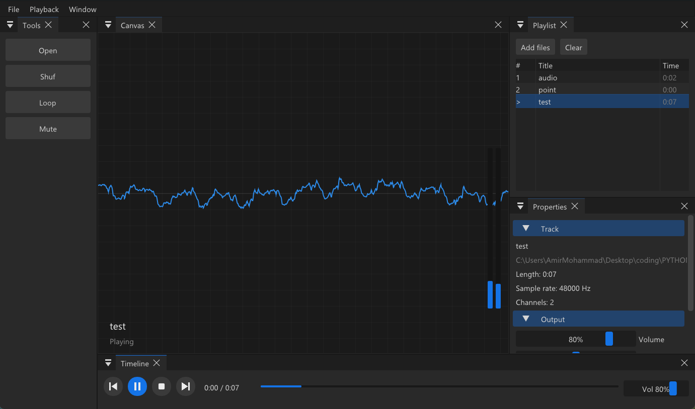

# Music Player

A lightweight desktop music player with a dark, dockable workspace inspired by Photoshop. Built in C++ with Dear ImGui, Direct3D 11 and miniaudio.




## Features

- **Dockable workspace.** Drag, tab, float and resize every panel. The layout is saved between sessions.
- **Live visualizer.** A real-time waveform and left/right level meters, driven by the audio that is actually playing.
- **Streaming playback.** MP3, WAV and FLAC, decoded on the fly through miniaudio.
- **Playlist management.** Drag and drop files or whole folders, double-click to play, right-click to remove.
- **Playback controls.** Play/pause, stop, previous/next, seek, shuffle, repeat, mute.
- **Output controls.** Volume, stereo pan and playback speed (0.5x to 2x).
- **Native feel.** Dark title bar, per-monitor DPI scaling and Segoe UI text.

## Workspace

| Panel | Purpose |
| --- | --- |
| Tools | Open files, shuffle, loop, mute |
| Canvas | Waveform and level meters for the current track |
| Playlist | Queue with track numbers and durations |
| Properties | Track details, volume, pan and speed |
| Timeline | Transport buttons, seek bar and volume |

Use **Window > Reset layout** to restore the default arrangement.

## Getting started

### Requirements

- Windows 10 or 11
- Visual Studio 2022 with the **Desktop development with C++** workload
- A GPU with Direct3D 11 support

All dependencies are vendored in `third_party/`, so there is nothing else to install.

### Build and run

1. Clone the repository.
2. Open `MusicPlayer.sln` in Visual Studio.
3. Select the **x64** platform and the **Debug** or **Release** configuration.
4. Press **F5**.

To build from the command line, run this in a Developer Command Prompt:

```
msbuild MusicPlayer.sln /p:Configuration=Release /p:Platform=x64
```

The executable is written to `bin\x64\<Configuration>\MusicPlayer.exe`.

## Usage

Add music with the **Open** button, **File > Open files**, or by dragging files and folders onto the window. Folders are scanned recursively.

| Action | Control |
| --- | --- |
| Play / pause | `Space` |
| Open files | `Ctrl+O` |
| Play a track | Double-click it in the playlist |
| Remove a track | Right-click it in the playlist |
| Seek | Drag the bar in the Timeline, then release |

## Project structure

```
MusicPlayer/
├── MusicPlayer.sln
├── MusicPlayer.vcxproj
├── src/
│   └── main.cpp            Application, audio engine and UI
└── third_party/
    ├── imgui/              Dear ImGui (docking branch) with Win32 and DX11 backends
    └── miniaudio/          Single-header audio engine and decoders
```

## Notes

- Supported formats are MP3, WAV and FLAC. Ogg Vorbis is not included.
- Changing speed also changes pitch.
- The layout is stored in `imgui.ini` in the working directory. Delete it, or use **Window > Reset layout**, to go back to the default.
- Windows only. The renderer uses Direct3D 11 and the file dialog uses the Win32 API.

## Built with

- [Dear ImGui](https://github.com/ocornut/imgui) (docking branch) for the interface
- [miniaudio](https://github.com/mackron/miniaudio) for audio playback and decoding

## License

Released under the MIT License. See `LICENSE` for details.

Dear ImGui is licensed under MIT. miniaudio is available under public domain or MIT-0.
